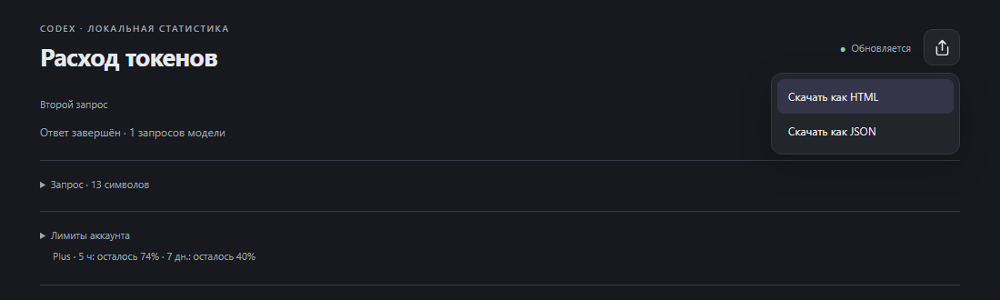
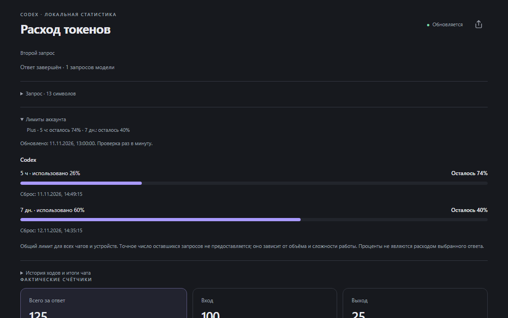

# Codex Token Lens

Локальный плагин для просмотра расхода токенов в Codex. Ссылка **«📊 Аналитика запроса/ответа»** открывает отчёт по конкретному ответу без ручного выбора чата и хода. Просмотр не запускает новый запрос к модели.

## Что показывает

- Фактические вход, выход, кэш, рассуждения и итог по запросам модели из локального журнала Codex.
- Оценку состава видимого входа: инструкции, схемы инструментов, история, контекст, вызовы и результаты инструментов.
- Потребителей результатов инструментов и таблицу запросов модели.
- Обновление открытого отчёта каждые 4 секунды, включая финальные счётчики, записанные после ответа.
- Раскрываемое превью запроса (до 200 символов) и длину исходного текста.
- Историю ходов этого чата, переход между ними и итог известных счётчиков по чату. Ходы без счётчиков и выполняющиеся ходы отмечаются отдельно.
- Самостоятельный HTML-отчёт в браузере и выгрузку HTML/JSON с историей чата.
- Лимиты аккаунта Codex: расход и остаток в процентах по окнам, срок сброса и свежесть данных.
- **Все отчёты**: ответы разных чатов, страницы по 50 записей и переход к выбранному ответу. Доступен в MCP-панели и браузере; открытие плагина без ссылки показывает каталог.
- **Настройки**: выбор MCP/браузера, необязательные лимиты в конце ответа и автоочистка старых отчётов.
- Выбор нескольких отчётов и удаление после подтверждения. Удалённые отчёты исключаются из каталога, истории и новых выгрузок; старая ссылка показывает сообщение об удалении.

Кэш уже входит во вход; рассуждения уже входят в выход. Категории контекста оцениваются как UTF-8 байт / 3 на шагах модели и не являются точным распределением фактического расхода API или денежным счётом.

## Установка

Требуются Node.js 22+, npm и локальный Codex с поддержкой плагинов и MCP Apps. Для лимитов аккаунта нужен `codex` в PATH (`codex --version`) и выполненный вход в Codex через ChatGPT.

Откройте терминал **в корне репозитория `token-lens`**, рядом с корневым README, и выполните:

```sh
cd adapters/codex
npm ci --ignore-scripts
npm run build
codex plugin marketplace add ../..
codex plugin add codex-token-lens@token-lens-local
node scripts/enable-default.cjs
```

`npm run build` собирает сервер и HTML-панель в `package/`. Каталог плагинов находится в корне репозитория, поэтому команда регистрации использует `../..`. Последняя команда включает ссылки после каждого ответа во всех проектах — её действие описано ниже.

После установки или обновления **полностью перезапустите Codex**. Уже работающий процесс MCP может продолжать использовать предыдущую версию, даже если новая версия установлена.

Проверьте `codex plugin list --marketplace token-lens-local`: в списке должен быть `codex-token-lens`. В новом чате дождитесь ответа и нажмите единственную ссылку «📊 Аналитика запроса/ответа». По умолчанию откроется панель этого ответа; для открытия в браузере выберите режим ниже. Если MCP-переход не работает, проверьте, что плагин включён и старые процессы Codex завершены, либо переключите `reportView` на `browser`. Отсутствие локального журнала обозначается в отчёте явно.

Установка через локальный каталог и CLI описана в [официальной документации OpenAI](https://developers.openai.com/plugins/build/plugins).

## Обновление

В корне Git-копии выполните `git pull --ff-only` (для ZIP скачайте свежий архив), затем повторите команды установки выше. Сначала пересоберите `package/`, затем переустановите плагин и полностью перезапустите Codex. Данные чатов хранятся отдельно от репозитория.

Если старый `token-lens-local` зарегистрирован из другого каталога и CLI сообщает `already added from a different source`, из `adapters/codex` выполните `codex plugin marketplace remove token-lens-local`, затем повторите `codex plugin marketplace add ../..` и установку плагина. Это заменяет путь каталога; журналы чатов остаются на месте.

## Ссылка после каждого ответа

Чтобы включить ссылки по умолчанию во всех проектах:

```sh
node scripts/enable-default.cjs
```

Установщик сохраняет существующие инструкции и добавляет отдельную секцию в `~/.codex/AGENTS.md`, помощник — в `~/.codex/tools/token-usage-link.cjs`, а его автономный runtime — в `~/.codex/tools/token-lens/`. Если задан `CODEX_HOME`, используется этот каталог. Упоминать плагин в каждом запросе не требуется.

Это правило поведения агента. Плагин не внедряет штатную кнопку в клиент Codex. Для отключения удалите секцию между `codex-token-lens-default:start` и `codex-token-lens-default:end` в глобальном `AGENTS.md`.

Для ручного формирования ссылки в окружении текущего чата:

```sh
node dist/link.cjs
```

Помощник читает `CODEX_THREAD_ID` и текущий ход из локального журнала. В ссылке сохраняются ID чата и хода, поэтому она продолжает указывать на тот же ответ после следующих сообщений.

## Настройка вида отчёта

В конце ответа всегда **одна ссылка** с названием «📊 Аналитика запроса/ответа». Её назначение выбирается в файле `~/.codex/token-lens/config.json` (на Windows — `%USERPROFILE%\.codex\token-lens\config.json`; при заданном `CODEX_HOME` — внутри него).

Установщик `enable-default.cjs` или первый запуск помощника создаёт конфиг с настройкой по умолчанию:

```json
{
  "reportView": "mcp",
  "appendPlanLimits": false,
  "autoDeleteDays": 0
}
```

| Значение `reportView` | Что откроет ссылка |
| --- | --- |
| `mcp` | Встроенную MCP-панель Codex. Значение по умолчанию. |
| `browser` | Самостоятельный HTML-отчёт в обычном браузере, без MCP. |

Чтобы выбрать браузер, замените `"mcp"` на `"browser"` и сохраните файл. Переустановка и перезапуск Codex для переключения не нужны: помощник читает конфиг при каждом формировании ссылки. Уже опубликованные ссылки сохраняют прежнее назначение. Настройка общая для всех проектов этого пользователя; повторная установка её не перезаписывает. [Пример конфига в репозитории](config.example.json).

Эти же параметры доступны в разделе **Настройки**. Старые конфиги только с `reportView` поддерживаются: показ лимитов и автоочистка по умолчанию выключены. `appendPlanLimits` добавляет перед ссылкой остаток лимитов всего аккаунта: заголовок, каждое окно и пояснение на отдельных строках. Помощник ждёт CLI не больше 3 секунд и явно отмечает недоступность. `autoDeleteDays` — целое число от 0 до 3650; 0 выключает автоочистку.

При ошибке JSON, неизвестном параметре или неверном значении помощник выдаёт ошибку с путём файла; пользовательский конфиг остаётся нетронутым. Режим не переключается молча на другой.

## Каталог и удаление отчётов

В отчёте нажмите **Все отчёты**, выберите записи и нажмите **Удалить выбранные**. Перед записью появляется подтверждение. В браузере каталог доступен также по `/reports`, настройки — по `/settings` на том же локальном сервере.

Удаление работает только внутри Token Lens: создаёт отдельные отметки в `~/.codex/token-lens/deleted-reports/<чат>/<ход>.json`. **Файлы `~/.codex/sessions` не изменяются и место, занятое журналами Codex, не освобождается.** Уже скачанные HTML/JSON остаются независимыми копиями. История и итоги новых отчётов учитывают оставшиеся видимые ходы.

Автоочистка применяет тот же механизм к завершённым старым ходам при чтении каталога или отчёта; выполняющиеся ходы и ходы без даты не удаляются. Отключение автоочистки не восстанавливает ранее скрытые записи. Каталог сообщает о чатах, которые не удалось прочитать, включая журналы больше 64 МБ.

## HTML-отчёт и экспорт

В режиме `browser` единственная ссылка ведёт на `http://127.0.0.1:<порт>/answer?sessionId=…&turnId=…`. Помощник запускает отдельный локальный Node-процесс, только на loopback; модель и MCP для просмотра не нужны. Вид просмотра меняется через `reportView` в конфиге. Отчёт читает журнал заново каждые 4 секунды и подхватывает финальные счётчики после ответа.

Для получения адресов вручную выполните в окружении текущего чата:

```sh
node dist/link.cjs
```

JSON результата содержит выбранный `view`, адрес `url` и готовую строку `markdown` с одной ссылкой. В режиме `browser` также есть `htmlUrl` и `jsonUrl`. Если HTML-сервер не запустился, помощник сообщает причину и завершается с ошибкой. После перезапуска компьютера повторный запуск помощника в режиме `browser` поднимает сервер; пока сервер остановлен, HTTP-ссылки недоступны.

Нажмите значок **Поделиться** (квадрат со стрелкой вверх) в правом верхнем углу отчёта. В меню доступны **Скачать как HTML** и **Скачать как JSON**: они сохраняют снимок всех ходов текущего чата, включая выбранный ход, их счётчики и превью запросов. Отдельной кнопки просмотра HTML в панели нет. Меню закрывается кликом снаружи или Escape; пункты можно выбирать стрелками клавиатуры.



Скачанный HTML открывается в обычном браузере **без сети и без установленного плагина**; история ходов и JSON-экспорт продолжают работать. В сохранённом файле меню предлагает JSON-экспорт. Сохранённый файл не обновляется автоматически — дата снимка находится в JSON (`exportedAt`). В живом отчёте данные продолжают обновляться.

В обоих интерфейсах раскрывайте **Запрос**, чтобы увидеть превью и длину текста, и **История ходов и итоги чата**, чтобы выбрать другой ход. Кнопка **К исходному ответу** возвращает к ходу из первоначальной ссылки. Навигация в отчёте не меняет ссылку в сообщении. При отсутствующих счётчиках итог чата показывает сумму только известных данных, а не нулевую стоимость пропущенных ходов.

## Лимиты аккаунта

Блок **Лимиты аккаунта** показывает остаток включённого использования по окнам подписки, например за 5 часов и 7 дней. При раскрытии видны расход в процентах, полосы заполнения, время сброса и дата получения данных. Если сервис передаёт несколько пулов, они отображаются отдельно. Длительность окна берётся из ответа сервиса, а не задаётся заранее.

Источник — штатный метод `account/rateLimits/read` локального Codex App Server, описанный в [OpenAI Docs](https://learn.chatgpt.com/docs/app-server#6-rate-limits-chatgpt). Он запускается через установленный CLI с существующей авторизацией. Плагин не читает и не расшифровывает токены входа, не запускает вход в аккаунт, не отправляет сообщений модели и не расходует заработанные сбросы лимитов. Для нестандартного расположения бинарника можно задать `TOKEN_LENS_CODEX_BIN` с полным путём к исполняемому файлу Codex.

**Проценты — общий лимит аккаунта для всех чатов и устройств, а не расход выбранного ответа.** API не предоставляет фиксированного счётчика «N запросов из M». Количество сообщений зависит от модели, объёма и сложности работы; переводить процент в число запросов было бы недостоверно. См. [официальное объяснение лимитов](https://learn.chatgpt.com/docs/pricing#what-are-the-usage-limits-for-my-plan).

Данные запрашиваются в фоне при просмотре отчёта и кэшируются на минуту. Это не задерживает отображение токенов. При ошибке последние успешные данные сохраняются с пометкой **устаревшие данные**; при отсутствии истории показывается причина недоступности. Прошедшее время сброса не обнуляет проценты без нового ответа сервиса. Поля разрешения использования учитываются только тогда, когда сервис их явно передаёт.

В скачанном HTML и JSON сохраняется последний известный снимок лимитов; он не обновляется без подключения к Codex. Идентификатор аккаунта, email и данные авторизации в экспорт не включаются.



## Разработка и проверки

```sh
npm test
npx playwright install chromium
npm run test:ui
```

Основные тесты проверяют счётчики, изоляцию ходов, дубликаты, чтение журналов, границы доступа, установщик глобального правила и оба ранее опубликованных адреса ресурса MCP.

UI-проверка использует тестовый мост MCP Apps и Chromium на ширинах 375, 768 и 1440 пикселей. Она проверяет меню «Поделиться», клавиатуру, экспорт, автообновление, автономный HTML, каталог разных чатов, сохранение настроек и подтверждение удаления. Она не заменяет проверку перехода по ссылке в установленном Codex.

## Данные и ограничения

- MCP-сервер работает через stdio. Loopback HTTP-сервер запускается при формировании браузерной ссылки или подготовке экспорта внутри панели, с автоматически выбранным портом. Настройки находятся в `~/.codex/token-lens/config.json`, метаданные процесса — в `browser-server-<версия>.json` рядом; сами эти файлы и каталоги с журналами через HTTP не выдаются. Журналы не отправляются наружу; лимиты запрашиваются через авторизованный Codex CLI у сервиса Codex.
- Источник: `token_usage_record` в `~/.codex/sessions`; для старых журналов поддерживается `event_msg.token_count`. Формат журнала не является стабильным API Codex.
- Инструменты и экспорт возвращают агрегаты, короткие подписи и превью запросов до 200 символов с исходной длиной. Полные запросы и результаты инструментов не экспортируются. Превью может содержать приватный текст: учитывайте это при передаче выгрузки другим людям.
- Скрытые инструкции, серверная подготовка и точный состав модельных запросов могут отсутствовать в журнале.
- Вложенные инструменты внутри `functions.exec` объединены под `exec`.
- Расход субагентов и других чатов отдельно не суммируется. Журналы больше 64 МБ не поддерживаются.
- Ресурсы `ui://codex-token-lens/panel.html` и `ui://codex-token-lens/panel-v0.1.2.html` совместимы: Codex может кэшировать адрес панели между обновлениями.
- Реализована интеграция с Codex. Для OpenCode потребуется отдельная адаптация источника статистики, расширения интерфейса и ссылок.

Основа интеграции: [OpenAI MCP Extensions](https://developers.openai.com/plugins/build/extensions) и [спецификация deep links](https://github.com/openai/mcp-extensions/blob/main/docs/spec.md#deep-links).
